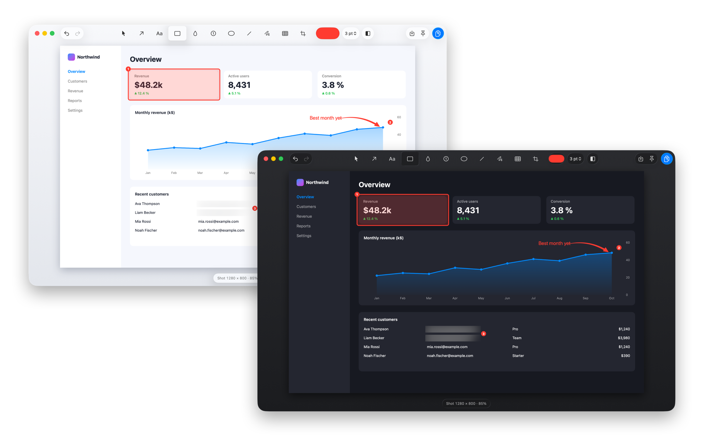

<h1 align="center">Snappy</h1>

<p align="center">
  A fast, native macOS screenshot tool: capture, OCR, annotate, pin and record.<br>
  Lives in your menu bar. Works fully offline.
</p>

<p align="center">
  
</p>

## Features

- 📸 **Capture:** area (⇧⌘4), full screen (⇧⌘3) or a single window. The screen freezes
  first, so open menus and tooltips can be captured.
- ⚡ **Preview panel** after every capture: Edit · Copy · Save · OCR · Pin · Record.
- ✏️ **Editor:** rectangle, oval, arrow, line, pen, text, counter badges, blur,
  pixelate and crop. Every annotation stays editable and undoable.
- 🔤 **OCR:** English and German text recognition, copied straight to your clipboard.
- 📌 **Pins:** keep any screenshot floating on top of your windows.
- 🎬 **Recording:** MP4 of an area or window, with live drawing and a fading
  "Magic Pen".

Every action has a keyboard shortcut, shown in its tooltip.

## 100 % native

Written in Swift with AppKit and Apple's own frameworks: ScreenCaptureKit,
Vision and Core Image. **No external libraries, no network code, no analytics.**
OCR runs on your Mac.


## Requirements

- macOS 26 (Tahoe) or newer
- Xcode Command Line Tools: `xcode-select --install` (full Xcode isn't needed)

## Install

### Homebrew (recommended)

```sh
brew install --cask tefa-m/snappy/snappy        # stable
brew install --cask tefa-m/snappy/snappy@beta   # beta: new features first, may be rough
```

Update with `brew upgrade --cask snappy` (or `snappy@beta`). The two can't be installed side
by side; to switch channels, uninstall one first, e.g.
`brew uninstall --cask snappy@beta && brew install --cask tefa-m/snappy/snappy`. Your settings
are kept.

The app is a universal binary, **ad-hoc signed, not notarized**, so Gatekeeper would block
the first launch. The cask removes the quarantine flag for you; if you downloaded the zip
from the [Releases page](https://github.com/tefa-m/snappy/releases) yourself, run
`xattr -dr com.apple.quarantine /Applications/Snappy.app` once. Every update has a new
signature, so macOS asks for Screen Recording permission again.

### From source

```sh
git clone https://github.com/tefa-m/snappy.git
cd snappy
./scripts/install.sh
```

That's it. `install.sh` builds Snappy and copies it to `/Applications`. Then start it with
`open /Applications/Snappy.app`; a Snappy icon appears in your menu bar. Run the script again
at any time to update (a running Snappy is restarted for you).

## First run

1. **Free up ⇧⌘4 and ⇧⌘3.** macOS reserves them for its own screenshots. Turn them off in
   *System Settings → Keyboard → Keyboard Shortcuts… → Screenshots*. Until then, use the
   menu bar icon.
2. **Allow Screen Recording** when macOS asks (*Privacy & Security → Screen & System Audio
   Recording*). You may need to reopen Snappy afterwards.
3. *Optional:* Accessibility, which lets recording snap to parts of a window, such as a
   browser's page area.

> **Permission lost after an update?** Run `./scripts/setup-signing.sh` once. It creates a
> local signing certificate so macOS keeps Snappy's permissions across rebuilds.

## Privacy

- Nothing leaves your Mac. The app contains no networking code (it isn't sandboxed, so
  this is a property of the source, not something macOS enforces).
- Saved screenshots go to `~/Desktop` by default (configurable); copied images and OCR text go
  to the clipboard.
- Blur and pixelate are **not secure redaction**. To hide a secret, crop it out.

## Uninstall

Installed with Homebrew: `brew uninstall --cask snappy` (or `snappy@beta`); add `--zap` to
also remove its settings and caches. Otherwise quit Snappy and delete `Snappy.app`. To also
remove its data:

```sh
defaults delete com.tefa.snappy
rm -rf ~/Library/Caches/com.tefa.snappy
```

## For developers

```sh
swift build           # debug build
./scripts/test.sh     # test suite (needs a normal logged-in macOS session)
```

See [`docs/ARCHITECTURE.md`](docs/ARCHITECTURE.md) for how it works and
[`docs/FEATURE_MAP.md`](docs/FEATURE_MAP.md) for the per-feature docs. Snappy was built with
the help of AI coding agents.

Releases (beta, stable, patch) are cut with `./scripts/release.sh`; see
[`features/versioning.md`](features/versioning.md).

## License

[MIT](LICENSE) © 2026 Mostafa Abdelkhalek.
